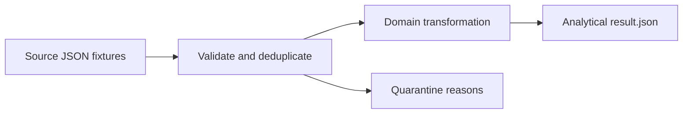

# Air Quality Quality Gates ETL

City analysts need comparable hourly PM2.5 measurements even when sensor feeds disagree on units or contain faulty stations. This project is a deterministic Node.js 24 ETL example using only built-in modules and synthetic data.



## Data and rules

`fixtures/readings.json` contains timestamped station readings; `fixtures/stations.json` maps station IDs to cities. One row per station and UTC hour.

- Convert `mg/m3` to `ug/m3` before aggregation; preserve integer or decimal sample values.
- Ignore exact duplicate event IDs; quarantine conflicting IDs, unknown stations, invalid measurements, and values above 1000 µg/m³.
- Require real ISO-8601 calendar timestamps with an explicit `Z` or numeric timezone offset; ambiguous local times are quarantined.
- The first valid row for an event ID wins; a later conflicting row is quarantined.
- Report sample counts and rounded hourly means. Quarantined records retain only IDs and reasons.

See the checked-in [example result](examples/result.json). The CLI overwrites that file deterministically; running it twice produces identical bytes.

## Run

Install Node.js 24. From this repository's root in PowerShell:

```powershell
node --test test/pipeline.test.mjs
node pipeline.mjs
```

No npm packages, external API keys, or database are needed. Tests cover the main calculation and a material data-quality failure. The 1000 µg/m³ bound is a demo quality gate, not a health standard or clinical guidance.
